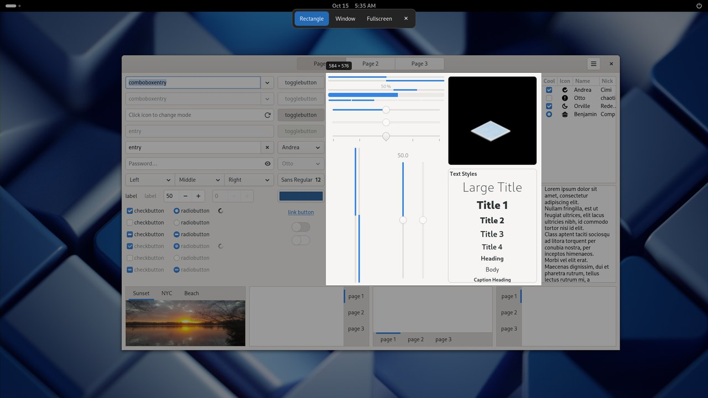
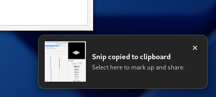
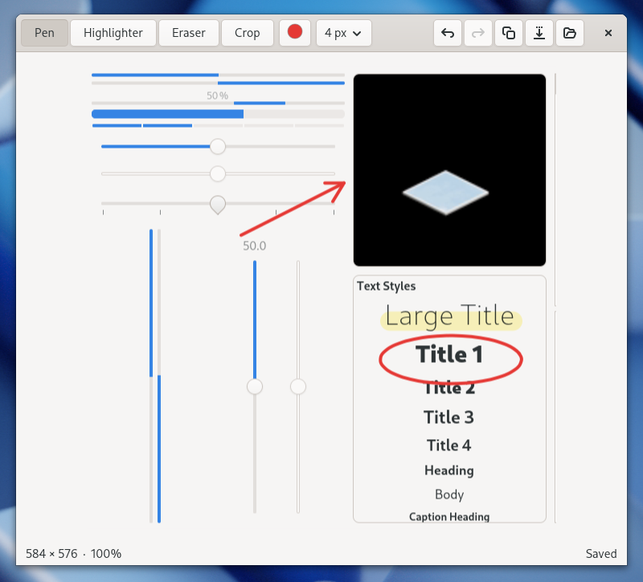

# WinSnipper

**Windows-style snipping for GNOME.** Inspired by the Windows Snipping Tool: press
**Super+Shift+S**, drag a region, and the snip is on your clipboard, ready to paste
or mark up.



Supports GNOME Shell 45–49 on Wayland and X11. Built for Zorin OS 18 (GNOME 46).

## Features

- **Freeze-frame capture.** The screen is captured the moment you press the
  shortcut, before any UI appears, so menus, tooltips and hover states stay in the shot.
- **Three modes:** Rectangle, Window or Fullscreen, chosen from the toolbar at the
  top of the screen. A live `W × H` label follows your selection.
- **Clipboard first.** Every snip is copied straight away and saved to
  `Pictures/Screenshots`. The clipboard image survives after the editor closes.
- **Notification toast.** A preview appears in the bottom-right corner. Click it
  to annotate.
- **Lightweight editor** (GTK 4): pen, highlighter, eraser and crop, with undo/redo.
  Your edits save back to the same file automatically.
- **HiDPI aware.** Crops are taken at the capture scale, so snips stay sharp on
  scaled displays.

<p align="center">
  
</p>

## The editor



| Action | Shortcut |
| --- | --- |
| Pen / Highlighter / Eraser / Crop | <kbd>P</kbd> / <kbd>H</kbd> / <kbd>E</kbd> / <kbd>X</kbd> |
| Apply crop | <kbd>Enter</kbd> |
| Cancel the current stroke or crop | <kbd>Esc</kbd> |
| Undo / Redo | <kbd>Ctrl</kbd>+<kbd>Z</kbd> / <kbd>Ctrl</kbd>+<kbd>Shift</kbd>+<kbd>Z</kbd> or <kbd>Ctrl</kbd>+<kbd>Y</kbd> |
| Copy the edited image | <kbd>Ctrl</kbd>+<kbd>C</kbd> |
| Save as… | <kbd>Ctrl</kbd>+<kbd>S</kbd> |
| Fit to window / Actual size | <kbd>Ctrl</kbd>+<kbd>0</kbd> / <kbd>Ctrl</kbd>+<kbd>1</kbd> |
| Zoom | <kbd>Ctrl</kbd>+scroll |
| Close | <kbd>Ctrl</kbd>+<kbd>W</kbd> |

Use the header bar to set the colour and stroke thickness. The folder button
opens the folder containing the screenshot.

## Install

### Debian package (recommended)

Download `winsnipper_*_all.deb` from the
[latest release](https://github.com/AKolenda/winsnipper/releases/latest), then:

```sh
sudo apt install ./winsnipper_*_all.deb
```

Log out and back in. On that first login WinSnipper takes over each user's
Super+Shift+S, backing up any binding it replaces.

- `winsnipper-setup --remove` restores the original bindings and disables WinSnipper.
- `winsnipper-setup` turns it back on.
- Run `winsnipper-setup --remove` before `sudo apt remove winsnipper`.

### From a checkout

```sh
./install.sh            # per-user, no sudo; add --dry-run to preview
```

The installer enables the extension and backs up conflicting Super+Shift+S
bindings. If GTK bindings are missing, it prints the `apt` command to install them.
**On Wayland, log out and back in once.**

`./uninstall.sh` (also supports `--dry-run`) removes the extension and editor and
restores your original shortcuts. Your screenshots are kept. Reinstalling keeps
the first shortcut backup. If new conflicts have appeared since you installed,
uninstall first so a fresh backup is taken.

**Requirements:** GNOME Shell 45+, Python 3, PyGObject and GTK 4.

## Usage

1. Press **Super+Shift+S**.
2. Pick **Rectangle**, **Window** or **Fullscreen**, then drag or click.
   **Esc** or right-click cancels.
3. The snip is copied to the clipboard and saved. Click the toast to annotate it.
   Hovering over the toast stops it from closing.

Open the extension's preferences (Extensions app → WinSnipper) to change:

| Setting | Default |
| --- | --- |
| Save to disk | On. When off, the editor works on a copy in your user cache. |
| Save directory | `Pictures/Screenshots`. Also takes a network folder, see below. |
| Default mode | Rectangle |
| Toast timeout | 7 seconds (`0` keeps it until dismissed) |

### Saving to a network folder

Set **Save directory** to a Windows share such as `\\10.40.40.4\screenshots\Screenshots`,
or to any GIO location such as `smb://10.40.40.4/screenshots/Screenshots`. Snipping
stays just as fast: each snip is saved locally first (in `~/.cache/winsnipper`), and
the toast and editor work on that copy. It is then copied to the share in the
background, and copied again each time the editor saves an edit.

If the share is not mounted, WinSnipper mounts it with the password saved in your
keyring, or as a guest if the share allows that. To save the password, open the share
once in Files, enter it and choose **Remember forever**.

If the share can't be reached, snips wait in a queue and you get one notification.
The queue retries in the background (after 30 seconds, doubling up to every 10
minutes, and straight away when the network changes). It is saved to disk, so it
survives logging out. Snipping is never slowed down while the queue waits; the
snips stay in `~/.cache/winsnipper` until they are copied.

## How it works

The compositor captures the stage **before** the selection UI is created or any
input grab is taken. You then select on that frozen image, cropped at capture
scale for HiDPI. PNG encoding, the disk write and starting the editor over D-Bus
all happen asynchronously, after the overlay is gone. GNOME Shell itself owns the
clipboard image, so it survives the editor exiting. Pressing the shortcut again
during a snip does nothing.

## Troubleshooting

- **Shortcut does nothing:** on Wayland, log out and back in, then check
  `gnome-extensions info winsnipper@winsnipper.local`.
- **Errors:** run `journalctl --user -f /usr/bin/gnome-shell` and look for lines
  starting with `[winsnipper]`.
- **Editor doesn't open:** make sure `winsnipper-editor` is on your `PATH`, or at
  `~/.local/bin/winsnipper-editor` for checkout installs, and that you can write to
  the save directory.

## Development

```sh
node --test tests/*.test.js
python3 -m unittest discover -s tests -p 'test_keybindings.py'
find extension -name '*.js' -exec node --check {} \;
bash -n install.sh uninstall.sh && shellcheck install.sh uninstall.sh
gjs -m tests/gjs-io-smoke.js   # optional GJS IO / activation-signature check
gjs -m tests/gjs-upload-smoke.js [smb://server/share/test-folder]   # optional upload-queue check
```

The capture, grab, clipboard and preview APIs were checked against upstream GNOME
Shell 45.0, 46.0, 47.0, 48.0 and 49.0. Desktop integration still needs testing in
a real session.

Every push to `master` builds and publishes a release
(`.github/workflows/release.yml`, versioned as `VERSION` plus the run number).
To build a package locally, run `packaging/build-deb.sh 0.1.0`.

## License

WinSnipper is free software, released under the
[GNU Affero General Public License v3.0](LICENSE) (AGPL-3.0-only). It is not
affiliated with or endorsed by Microsoft.
